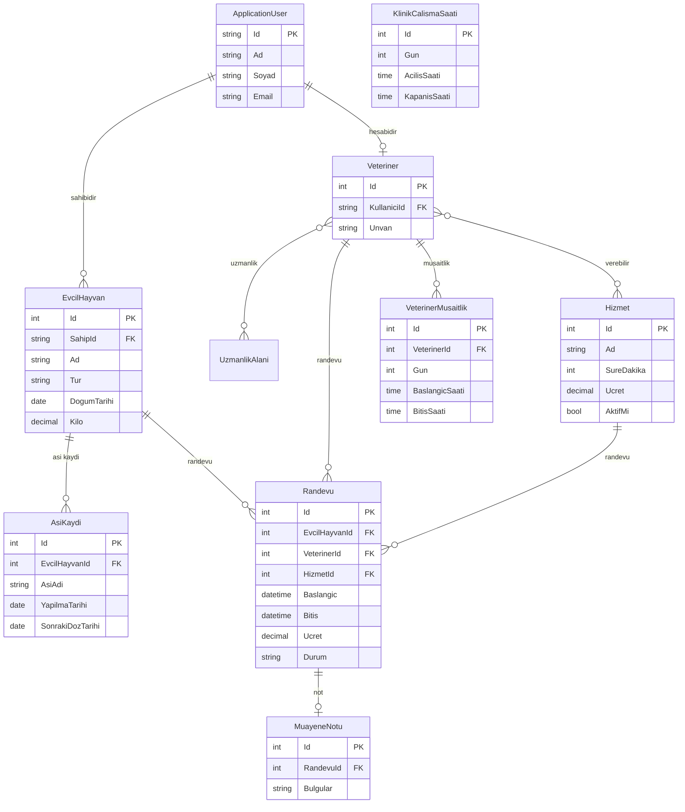

# Veteriner Kliniği Randevu ve Hasta Takip Sistemi

- **Öğrenci No:** B241210104
- **Ad Soyad:** Pelinsu Kahraman
- **Ders Grubu:** 1A
- **GitHub:** https://github.com/pelinsukhrmn/VetKlinik

## Proje Hakkında
ASP.NET Core MVC (.NET 10) ile geliştirilen; klinik hizmetlerini, veteriner hekimleri,
evcil hayvanların muayene ve aşı geçmişini ve randevuları yöneten bir web uygulaması.
REST API ve yapay zekâ asistanlarının kullanabileceği bir MCP sunucusu içerir.

## Veritabanı Modeli

Tek klinik üzerinde çalışılmaktadır. Randevu, oluşturulduğu andaki ücret ve süreyi kendi içinde saklar; böylece hizmet fiyatı değişse de geçmiş kayıtlar ve ciro raporu doğru kalır.